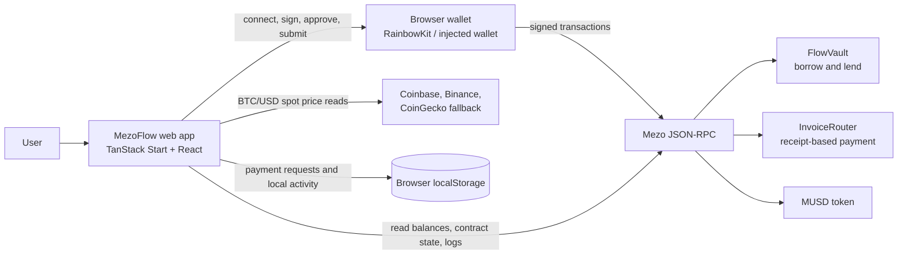
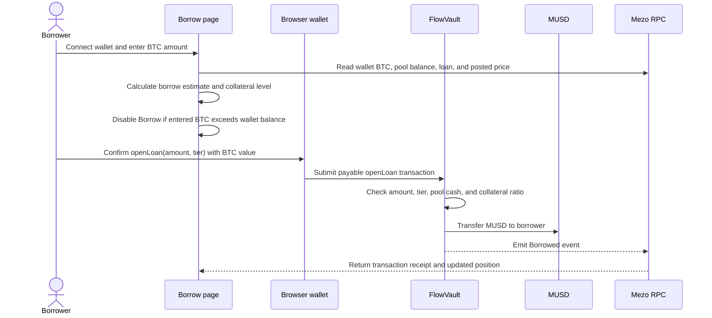
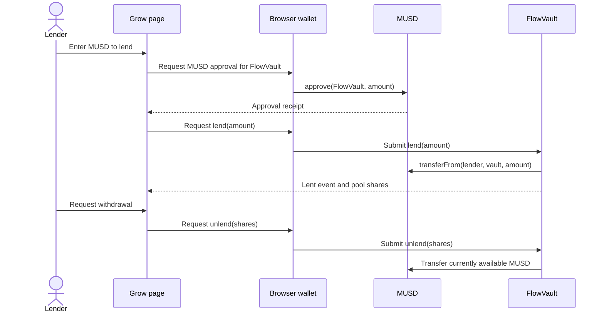
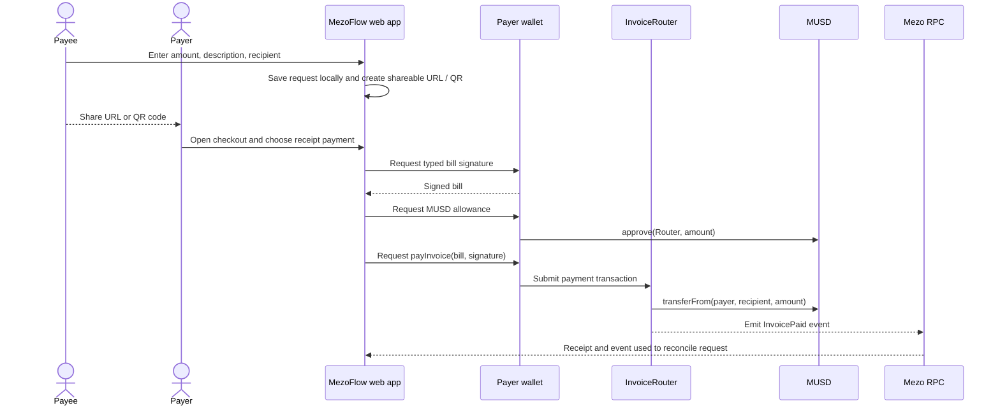

# MezoFlow

**Borrow MUSD against BTC, lend MUSD to a shared pool, and request MUSD with payment links.**

MezoFlow is a wallet-connected Mezo application for Bitcoin-backed borrowing, MUSD lending, and simple MUSD payment requests. It was built for the **Build with MUSD and MEZO** event and is currently a testnet prototype.

| Resource | Link |
| --- | --- |
| Live application | [https://mezocredits.vercel.app](https://mezocredits.vercel.app/) |
| Source repository | [github.com/dinitheth/Mezo-Credits](https://github.com/dinitheth/Mezo-Credits) |
| Smart contracts and deployment notes | [contracts/](https://github.com/dinitheth/Mezo-Credits/tree/main/contracts) |
| Automated tests | [tests/](https://github.com/dinitheth/Mezo-Credits/tree/main/tests) |

> [!WARNING]
> MezoFlow and its custom contracts are experimental and intended for Mezo Testnet. The contracts have not been independently audited. Do not use real funds. The deployed receipt-payment router has a known signature parsing bug and must be replaced before receipt-based checkout can work.

## Contents

- [Product scope](#product-scope)
- [System architecture](#system-architecture)
- [User workflows](#user-workflows)
- [Contracts and economic rules](#contracts-and-economic-rules)
- [Data ownership and source of truth](#data-ownership-and-source-of-truth)
- [Network and deployment status](#network-and-deployment-status)
- [Technology](#technology)
- [Local development](#local-development)
- [Configuration](#configuration)
- [Tests](#tests)
- [Buildathon track fit](#buildathon-track-fit)
- [Known limitations and next steps](#known-limitations-and-next-steps)

## Product scope

MezoFlow connects three related tasks in one interface:

1. Bitcoin holders lock native BTC as collateral and borrow MUSD from a pool.
2. MUSD holders lend to that pool and receive an accounting share of pool assets.
3. A person or business creates a shareable MUSD payment request; the payer opens the link and sends MUSD from a connected wallet.

The app is designed for Bitcoin holders who need dollar liquidity without selling BTC, and freelancers or small merchants who want to request MUSD with a link or QR code. The project uses MUSD in its core flows. MEZO is not required for borrowing, lending, or payments.

### Application routes

| Route | Purpose |
| --- | --- |
| `/` | Product landing page, BTC market price, and links to app actions |
| `/borrow` | Borrow planner and `FlowVault.openLoan` workflow |
| `/earn` | Lend MUSD, view pool shares, and withdraw available cash |
| `/dashboard` | View a wallet's loan and perform repayment or collateral actions |
| `/pay` | Create and manage browser-side payment requests; view incoming MUSD |
| `/checkout` | Review a bill and pay directly or through the payment router |
| `/activity` | View wallet activity and transaction receipts |
| `/how-it-works` | User-facing explanation of borrowing and payments |

## System architecture

The app is a browser-first client. Wallets authorize signatures and transactions; the app does not custody keys or hold funds off-chain. Contract state and transaction receipts are read from the Mezo JSON-RPC endpoint. Payment-request records and the app's activity list are stored locally in the user's browser.



### Important trust boundaries

| Information or action | Source of truth | Notes |
| --- | --- | --- |
| MUSD balances and contract positions | Mezo contracts via RPC | The UI reads live chain data; a displayed estimate is not a confirmed transaction. |
| Submitted transaction | Connected wallet and Mezo receipt | The app records activity only after it receives a real transaction hash, then updates status from the receipt. |
| BTC/USD display price | Coinbase, then Binance, then CoinGecko | Market price is used for planning and for the owner-posted pool price update. It is not an oracle feed enforced by `FlowVault`. |
| Payment request details | URL plus creator's browser storage | Creating a request does not write an invoice to a contract or a shared database. The link carries the requested amount, description, and recipient. |
| Local activity and saved requests | Browser `localStorage` | Local history is device/browser-specific. The blockchain remains authoritative for successful contract events and token transfers. |

## User workflows

### Borrow MUSD against BTC



1. The page reads the connected wallet's native BTC balance and the pool's available MUSD.
2. It estimates borrowing power at 250%, 200%, or 150% collateral. The estimate is informational; `FlowVault` enforces the selected ratio against its own posted BTC price.
3. The Borrow button is disabled when the entered collateral exceeds the wallet's BTC balance or when that balance cannot be read. The balance is checked again before submitting.
4. The wallet submits `openLoan(amount, tier)` with native BTC as `msg.value`. The contract updates loan accounting and transfers MUSD to the borrower.
5. The wallet needs additional native BTC for gas, so the entire wallet balance should not be entered as collateral.

### Lend MUSD and withdraw



Pool shares are internal contract accounting, not a transferable ERC-20 token. A withdrawal can only be paid from MUSD currently held as pool cash; the portion lent to borrowers becomes available as loans are repaid.

### Create and pay a MUSD request



The direct-payment option sends MUSD straight to the recipient. It is a normal token transfer and does not produce the router's `InvoicePaid` event, so it does not automatically mark the saved request as paid. The receipt-based route is designed to sign the exact bill, approve the requested amount, transfer MUSD, and emit an event. **The currently configured router deployment has a signature parsing defect; do not rely on that route until a corrected router is deployed and configured.**

## Contracts and economic rules

### `FlowVault.sol`

The lending pool tracks MUSD cash, lender shares, and each borrower's BTC backing and MUSD debt.

| Function | Effect |
| --- | --- |
| `lend(amount)` | Pulls MUSD from the lender and issues internal pool shares. Requires prior MUSD approval. |
| `unlend(shares)` | Burns the lender's shares and transfers the corresponding available pool cash. |
| `openLoan(amount, tier)` | Accepts native BTC, checks the tier, pool liquidity, and collateral ratio, then sends MUSD to the borrower. |
| `repay(amount)` | Pulls MUSD from the borrower and returns repaid principal and accrued fees to pool cash. Requires prior approval. |
| `addBacking()` | Adds native BTC to an existing loan. |
| `takeBacking(amount)` | Returns collateral only if the remaining position meets the contract's 150% withdrawal safety floor. |
| `closeLoan(who)` | Allows anyone to repay a position below 110% backing and receive its collateral. |
| `setPrice(price)` | Lets the contract owner update the USD-per-BTC price used by contract calculations. |

The contract accrues a 1% annual fee over time. Accrued fees become pool cash when repaid; they are not paid out continuously. The contract stores one posted price and uses it for collateral math.

### `InvoiceRouter.sol`

The router accepts a signed bill containing payer, bill ID, amount, recipient, description, deadline, and nonce. It checks the deadline and replay-protection nonce, verifies the payer signature, transfers MUSD with `transferFrom`, and emits `InvoicePaid`. The payer must first approve the router to spend the bill amount.

The current first deployment has a signature parsing bug in `_splitSig`. The corrected source reads `r`, `s`, and `v` from the correct calldata offsets, but contract code is immutable. A replacement router deployment and frontend address update are required. Deployment steps are documented in [`contracts/README.md`](contracts/README.md).

## Data ownership and source of truth

- The app has no application database or backend account system.
- Payment requests are plain browser records and encoded into shareable links; they are not tokenized invoices.
- A payer's successful direct MUSD transfer can be read from the token's `Transfer` event.
- A successful router payment can be reconciled from `InvoicePaid`, matched to the request ID.
- Browser activity is a convenience view. Transaction receipts and contract state on Mezo are authoritative.
- Wallet signatures and transactions are initiated by explicit user actions. The app never asks for or stores a seed phrase or private key.

## Network and deployment status

| Item | Mezo Testnet value |
| --- | --- |
| Chain ID | `31611` (`0x7b7b`) |
| RPC | [https://rpc.test.mezo.org](https://rpc.test.mezo.org) |
| Explorer | [https://explorer.test.mezo.org](https://explorer.test.mezo.org) |
| MUSD | `0x118917a40FAF1CD7a13dB0Ef56C86De7973Ac503` |
| First `InvoiceRouter` deployment | `0x99A9554C090C206a3811604448E5a29CAaB00d45` — defective signature parser; replacement required |
| First `FlowVault` deployment | `0x241af24502bD8DC163c1163Cdb35E9845510544f` |

Mezo mainnet MUSD is configured in the app, but MezoFlow's router and vault are not deployed to mainnet. The frontend should not be described as mainnet lending or payment infrastructure.

## Technology

- **UI and routing:** React 19, TypeScript, TanStack Start, Vite 8
- **Styling and components:** Tailwind CSS 4, Radix UI components
- **Wallet connectivity:** RainbowKit and wagmi, with injected browser wallets configured for Mezo networks
- **Chain interaction:** viem and JSON-RPC reads/writes
- **Contracts:** Solidity 0.8.20, `FlowVault`, and `InvoiceRouter`
- **Package manager:** Bun
- **Hosting:** Vercel deployment; client settings are supplied as `VITE_*` environment variables

## Local development

### Requirements

- Bun installed
- An EVM wallet for transactions on Mezo Testnet
- Test MUSD and native testnet BTC for exercising contract flows

### Start the app

```sh
bun install
bun run dev
```

Vite prints the local URL. Connect a wallet and select Mezo Testnet before trying a write action.

### Production build and tests

```sh
bun run test
bun run build
```

The test suite covers formatting, wallet connection and network behavior, app routes, receipt decoding, bill reconciliation, Mezo math, UI behavior, and error handling. These commands describe how to run checks; consult CI or run them locally for current results.

## Configuration

Copy `.env.example` to `.env` for local overrides. Never put private keys or secrets in `VITE_*` variables: Vite exposes them to browser code. These values are public contract/network configuration.

| Variable | Purpose |
| --- | --- |
| `VITE_ROUTER_ADDRESS_TESTNET` | InvoiceRouter address on Mezo Testnet; set this to the corrected deployment before enabling receipt payments. |
| `VITE_ROUTER_ADDRESS_MAINNET` | InvoiceRouter address on Mezo Mainnet, once deployed. |
| `VITE_VAULT_ADDRESS_TESTNET` | FlowVault address on Mezo Testnet. |
| `VITE_VAULT_ADDRESS_MAINNET` | FlowVault address on Mezo Mainnet, once deployed. |
| `VITE_FLOW_START_BLOCK_TESTNET` | Starting block for testnet receipt/event scans. |
| `VITE_FLOW_START_BLOCK_MAINNET` | Starting block for mainnet receipt/event scans. |
| `VITE_MEZO_TOKEN_TESTNET` | Optional MEZO token address for display. |
| `VITE_MEZO_TOKEN_MAINNET` | Optional MEZO token address for display. |

After changing deployment addresses in Vercel, redeploy the frontend so the client bundle uses the new values. Contract deployment and constructor instructions are in [`contracts/README.md`](contracts/README.md).

## Tests

Tests are in [`tests/`](tests/). Run them with:

```sh
bun run test
```

The suite is not a substitute for contract review, testnet transaction verification, or an independent security audit. The current repo test coverage does not make the deployed contracts production-safe.

## Buildathon track fit

- **Track 1 — DeFi:** MUSD is supplied as productive lending capital and borrowed from the pool against BTC collateral.
- **Track 2 — Access and Distribution:** A browser wallet interface, shareable payment links, and QR checkout reduce steps for requesting and sending MUSD.

MezoFlow integrates MUSD. MEZO is not needed for these core workflows.

## Known limitations and next steps

1. Deploy the corrected `InvoiceRouter` and configure its new address in Vercel; verify a small receipt-based payment end to end.
2. Keep the Borrow screen's wallet BTC balance guard synchronized with the latest wallet balance and retain enough BTC for gas.
3. Replace the owner-posted BTC price with a reliable on-chain oracle or another trust-minimized source. The current 15-minute freshness pause is enforced by the app, not by `FlowVault`, so direct contract calls can bypass it.
4. Add broader contract tests and obtain independent review before any mainnet deployment.
5. Consider a shared bill/indexing service if payment requests need to sync across devices without relying on a saved link and local browser storage.
